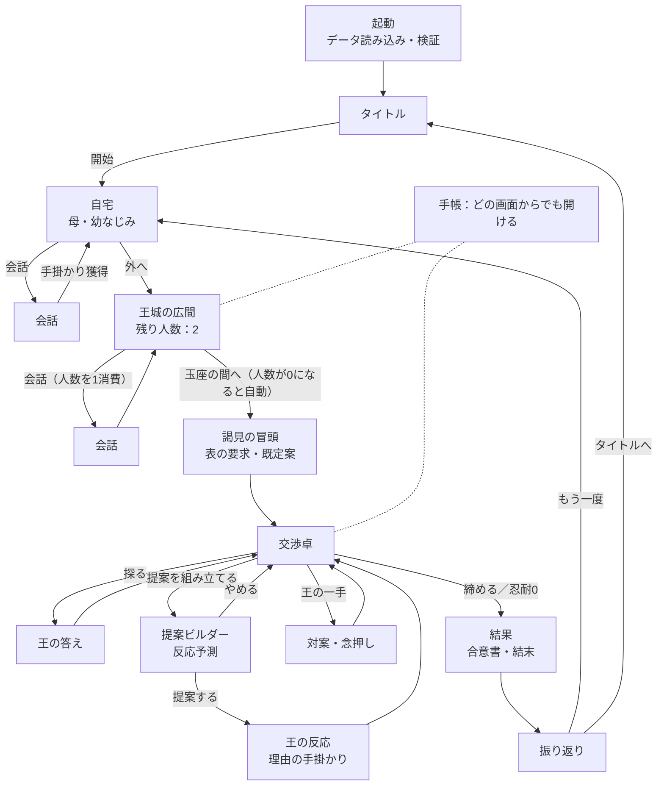

# Negotiation Quest 初期デモ（MVP）仕様書 v2

- ステータス：設計案（プログラム未着手）／更新日 2026-11-22
- 変更履歴：v1（カードバトル型）→ v2（情報・推測・提案型）。v1 は `docs/archive/DESIGN_MVP_v1.md` に保存
- 関連文書：
  - `DESIGN_REVIEW.md`：v1 の問題点と改善方針
  - `GAME_SYSTEM_DESIGN.md`：ゲームシステムとシナリオの詳細（**ルールと数値の正本**）
- タグ：【企画】企画書に記載／【依頼】依頼文に記載／【提案】本書の提案／【未決】判断が必要

---

## 1. 要件の整理（v2 で更新）

### 1.1 このデモで検証すること

> プレイヤーが「情報を得たことで、自分では思いつかなかった解決策を発見できた」と感じられるか。【依頼】

これは企画書の中心仮説「状況に応じて知識を使えたか」【企画】を、具体的な体験として言い換えたものです。

### 1.2 要件と出典

| # | 要件 | 出典 | v2 での実現方法 |
|---|---|---|---|
| R1 | 自宅から旅立ち、王城で王と会話する | 企画 §1、依頼 | 自宅 → 王城 → 謁見 |
| R2 | 選択式で情報を集める。正誤を設定しない | 企画 §5.1、依頼 | 探索（城で話せるのは2人）と、謁見中の探り。外れの選択肢はない |
| R3 | 情報がカードになる | 企画 §5.2、依頼 | 手掛かりカード（4つの役割） |
| R4 | 裏の事情を推測する | 依頼 | 気づき（推測 → 確信） |
| R5 | 情報から新しい解決策を発見する。組み合わせで選択肢が開く | 依頼 | 提案の部品と形。気づきの組み合わせで開く |
| R6 | 解決策を提案し、相手の反応を見て進める | 依頼 | 交渉卓（ラウンド制）、反応と理由、王の一手 |
| R7 | 勝利は相手の打倒ではなく、双方が受け入れられる合意 | 企画 §5.3、依頼 | 合意書と2軸評価（主人公の得・王の満足） |
| R8 | 複数の合意ルート。それぞれにトレードオフがある | 依頼 | R0〜R6（`GAME_SYSTEM_DESIGN.md` §4.7） |
| R9 | 情報がなくても交渉できるが、情報があれば可能性が広がる | 依頼 | 既定案、情報なしでの合意、断られたときの理由の手掛かり |
| R10 | 振り返りで交渉理論とつなぐ。説教調にしない | 企画 §7、依頼 | 王の本音、判断3つ、あり得た別の合意、概念タグ |
| R11 | 相手の意図・特性・隠れた事情 | 企画 §5.2 | 反応の4分類、特性「時間重視」「面子」、隠れた事情「国庫」 |
| R12 | デッキ構築 | 企画 §5.2 | **MVP では削除**（【未決】D1、`DESIGN_REVIEW.md` §6） |
| R13 | ランダムイベント | 企画 §5.2 | **MVP では入れない**（【未決】D4） |
| R14 | Godot 4／GDScript／JSON・CSV／日英／デスクトップと HTML5 | 企画 §8・§9、依頼 | v1 の方針を引き継ぐ |
| R15 | AI API に接続しない。自由入力は将来の拡張 | 企画 §5.1、依頼 | 接続しない。将来は自由入力を「探り／部品」に変換する境界を設ける |

### 1.3 企画書のMVP受け入れ基準（§13）との対応

| 基準 | v2 での担保方法 |
|---|---|
| 探索・対話・交渉・振り返りが途切れずに遊べる | 通しプレイのスモークテスト |
| 対話で得た2種類以上の情報が、具体的な差を生む | 手掛かりで部品・根拠・気づきが変わる。全探索テストで「手掛かりの組み合わせ → 到達できる結果」の差を確認する |
| 意図表示を見て次の手を考える余地がある | 反応予測、予兆、王の一手 |
| 勝利が条件を満たす合意として理解できる | 合意書を常に表示する |
| 選択と概念の接続を確認できる | 振り返り画面 |
| 日英の両方で理解可能な品質で動く | 【未決】U1（v1 から継続） |
| デスクトップと HTML5 で基本ループを起動できる | 両方でのスモークテスト |

---

## 2. MVP 機能一覧

| ID | 機能 | 優先度 | 備考 |
|---|---|---|---|
| F01 | タイトル（開始・言語切替・終了） | Must | |
| F02 | 自宅：移動、母・幼なじみと会話 | Must | C1・C2 |
| F03 | 王城：4人の NPC。謁見の刻まで話せるのは2人 | Must | C3〜C6。残り人数を表示する |
| F04 | 会話システム（文字送り、話者名、選択肢、条件、効果、判断ログ） | Must | v1 から継続 |
| F05 | 手帳（手掛かりカード、気づき、王について分かったこと） | Must | どの画面からでも開ける |
| F06 | 気づきの自動生成と「ひらめき」演出 | Must | |
| F07 | 謁見の冒頭（王の表の要求、大臣の既定案） | Must | |
| F08 | 交渉卓：忍耐（砂時計）、心証（表情）、ラウンドの進行 | Must | |
| F09 | 行動：探る／提案／人払い／締める | Must | |
| F10 | 提案の組み立て（求める・差し出す・形・根拠の各枠、制約チェック） | Must | 中心となる UI |
| F11 | 反応予測（利害ごとに 確信／推測／未知 で表示） | Must | |
| F12 | 王の反応（受諾・対案・保留・拒否）と理由の手掛かり | Must | |
| F13 | 王の一手（K1 期限の念押し、K2 大臣の咳払い、K3 人払い） | Must | |
| F14 | 合意書（4つの枠）の常時表示 | Must | |
| F15 | 結果判定（既定案／双方納得／あなた寄り／王寄り／妥協）と結末の文章 | Must | |
| F16 | 振り返り（王の本音、2軸の図、判断3つ、あり得た別の合意、概念） | Must | |
| F17 | 判断ログ | Must | |
| F18 | 日英切替（全テキストのキー化） | Must（構造）／Should（英文の品質） | |
| F19 | HTML5 で通しプレイ | Must | |
| F20 | もう一度遊ぶ | Should | ルートの違いを体験するために重要 |
| F21 | 交渉ログ（これまでのやり取りの一覧） | Should | |
| F22 | 初回だけの操作ガイド | Should | |
| F23 | 解放済みルートの記録（「見つけた合意」一覧） | Could | 再プレイの動機になる |
| — | デッキ構築、ドロー、AP、ゲージ群、ランダムイベント、セーブ、自由入力、AI | 対象外 | |

想定プレイ時間：1周 15〜20分。2周目以降は 8〜12分【提案】

---

## 3. ゲームシステムの概要

ルールと数値の正本は `GAME_SYSTEM_DESIGN.md` です。ここでは実装に必要な要点だけをまとめます。

- **手掛かり**（11種）は、気づきの材料／部品を開く／根拠になる／探りを開く、の役割を持つ（§3.1）。
- **気づき**（4種）は、手掛かりの組み合わせで自動的に生まれる。確度は「推測」と「確信」（§3.2）。
- **交渉卓**：忍耐6。1行動で1減り、拒否されるとさらに1減る（§3.3）。
- **提案**：求める（最大2）、差し出す（最大2）、形（最大1）、根拠（最大1）（§3.4）。
- **受け入れの計算**：S = Σ（重み × 影響）＋ 心証の補正。S ≥ 1 で受諾、0 で対案、−1 で保留、−2 以下で拒否（§3.5）。
- **評価**：主人公の得（P）と王の満足（K）の2軸。双方納得は P ≥ 2 かつ K ≥ 2（§3.9）。

---

## 4. 画面遷移



### 4.1 交渉卓のレイアウト案【提案】

```
┌──────────────────────────────────────────────────────────────┐
│ [王の肖像：表情=好意]   忍耐 ⏳⏳⏳⏳□□        大臣の目 👁        │
│ 「三日のうちに発て」                       予兆：王は窓の日差しを… │
├───────────────────────────────┬──────────────────────────────┤
│ 提案ビルダー                   │ 手帳                          │
│ 求める   [倉の余剰物資][準備期間]│ 手掛かり：C3 C6 C7 C9 …        │
│ 差し出す [伝書鳩で報告][     ] │ 気づき：                      │
│ 形      [段階支援]             │  H1 国庫が苦しい（推測）       │
│ 根拠    [     ]                │  H2 会議前の情報（確信）       │
│ ── 反応予測 ──                 │ 王について：                  │
│ 国庫 ▲?  時間 ±0（重要度：中）  │  国庫？ 時間◎ 面子？ 民？       │
│ 面子 ？？  民 ？？              │                              │
├───────────────────────────────┴──────────────────────────────┤
│ 合意書：支え[    ] 同行者[    ] 出発[三日以内] 見返り[    ]       │
│ 既定案：銀貨二十枚・明朝出発                                    │
│ [探る] [提案する] [人払いを願う] [締める]                        │
└──────────────────────────────────────────────────────────────┘
```

- 1280×720 で、英語でも文字がはみ出さない幅を確保する。部品カードは名前だけを表示し、マウスを乗せると説明が出る。

---

## 5. Godot ディレクトリ構成（v2）

```
negotiation-quest/
├── project.godot
├── docs/                 # 企画書・設計書（archive/ に旧版）
├── data/
│   ├── clues/clues.json
│   ├── hypotheses/hypotheses.json
│   ├── terms/terms.json              # 提案の部品（求める／差し出す／形）
│   ├── opponents/king.json           # 利害・重み・反応の閾値・対案の候補・王の一手・反応の文章キー
│   ├── scenarios/sc01_king_audience.json  # 合意書の枠、既定案、忍耐、探り、結果判定、振り返り
│   ├── dialogues/{home_mother,home_friend,castle_minister,castle_guard,castle_scribe,castle_keeper,audience_open}.json
│   ├── concepts/concepts.json
│   └── schema/
├── localization/{strings_ui,strings_dialogue,strings_terms,strings_reactions,strings_reflection}.csv
├── scenes/
│   ├── boot/ title/ field/(Home, Castle, Player)
│   ├── dialogue/DialogueBox.tscn
│   ├── notebook/Notebook.tscn               # 手帳
│   ├── negotiation/NegotiationTable.tscn    # 交渉卓
│   ├── negotiation/ProposalBuilder.tscn
│   ├── negotiation/ReactionForecast.tscn
│   ├── negotiation/DealSheet.tscn
│   ├── result/Result.tscn
│   └── reflection/Reflection.tscn
├── scripts/
│   ├── autoload/ DataRegistry.gd  RunState.gd  SceneRouter.gd  Settings.gd
│   ├── core/                          # Node に依存しない純ロジック（テスト対象）
│   │   ├── common/Condition.gd
│   │   ├── dialogue/DialogueEngine.gd
│   │   ├── knowledge/KnowledgeState.gd     # 手掛かり → 気づき・確度・解放
│   │   ├── negotiation/NegotiationEngine.gd  # ラウンド、行動、王の一手
│   │   ├── negotiation/ProposalValidator.gd  # 枠・前提・衝突のチェック
│   │   ├── negotiation/OpponentModel.gd      # S の計算、反応の分類、理由の選択、対案
│   │   ├── negotiation/Forecast.gd           # 確度に応じた反応予測
│   │   ├── outcome/OutcomeEvaluator.gd       # P/K、結果の分類、結末の文章の組み立て
│   │   ├── outcome/DealSearch.gd             # 合意の全探索（振り返り・テスト共用）
│   │   └── reflection/ReflectionBuilder.gd
│   └── ui/
├── assets/{placeholder,fonts,audio}/
├── tests/{unit,data,sim}/
└── tools/                             # データ検証、翻訳キー抽出、ルート表の出力
```

- `DealSearch.gd` は、振り返りの「あり得た別の合意」と、バランスの全探索テストで**同じコードを使う**。

---

## 6. データ設計（v2）

共通ルールは v1 と同じです（ID は snake_case、表示文字列は翻訳キーだけ、`schema_version`、起動時の参照検証）。

### 6.1 手掛かり `data/clues/clues.json`

```json
{
  "schema_version": 1,
  "clues": [
    {
      "id": "c_friend_letter",
      "short": "C2",
      "source": "home_friend",
      "name_key": "clue.c_friend_letter.name",
      "text_key": "clue.c_friend_letter.text",
      "tags": ["merchant", "precedent"],
      "unlocks_terms": ["a_letter_of_credit"],
      "evidence_for": [{ "term": "a_letter_of_credit", "override": { "face": 0 } }],
      "concept_ids": ["information_gathering"]
    },
    {
      "id": "c_king_glance",
      "short": "C9",
      "source": "observation",
      "tags": ["treasury", "face"]
    }
  ]
}
```

### 6.2 気づき `data/hypotheses/hypotheses.json`

```json
{
  "schema_version": 1,
  "hypotheses": [
    {
      "id": "h_treasury",
      "short": "H1",
      "text_key": "hyp.h_treasury.text",
      "interest": "treasury",
      "sources": [
        { "all": ["c_minister_sigh", "c_king_glance"], "certainty": "guess" },
        { "all": ["c_king_confides"], "certainty": "confirmed" }
      ]
    },
    {
      "id": "h_face",
      "short": "H3",
      "interest": "face",
      "sources": [
        { "all": ["c_king_glance"], "certainty": "guess" },
        { "all": ["c_knight_commander"], "certainty": "guess" }
      ],
      "confirmed_by_events": ["private_audience"],
      "unlocks_actions": ["request_privacy"]
    }
  ]
}
```

- 確度は、すべての `sources` のうち最も高いものを採用する。

### 6.3 提案の部品 `data/terms/terms.json`

```json
{
  "schema_version": 1,
  "terms": [
    {
      "id": "a_letter_of_credit", "short": "A4", "kind": "ask", "slot": "support",
      "name_key": "term.a_letter_of_credit.name",
      "requires": [{ "clue": "c_friend_letter" }],
      "player": { "support": 3, "freedom": -1 },
      "king":   { "face": -1 },
      "epilogue_key": "epi.a_letter_of_credit",
      "concept_ids": ["expand_options"]
    },
    {
      "id": "o_pigeon_report", "short": "O2", "kind": "offer", "slot": "return",
      "requires": [{ "hypothesis": "h_time" }, { "clue": "c_scribe_pigeon" }],
      "excludes": ["o_envoy_report"],
      "player": { "freedom": -1 },
      "king":   { "time": 2 }
    },
    {
      "id": "f_staged_support", "short": "F1", "kind": "form", "attaches_to_slot": "support",
      "attaches_to_terms": ["a_funds_large", "a_funds_small", "a_surplus_goods"],
      "requires": [{ "hypothesis": "h_treasury" }, { "hypothesis": "h_time" }],
      "requires_in_deal_or_proposal": { "any": ["o_pigeon_report", "o_envoy_report"] },
      "player": {},
      "king": { "treasury": 1 }
    }
  ]
}
```

### 6.4 相手 `data/opponents/king.json`

```json
{
  "schema_version": 1,
  "id": "king",
  "interests": [
    { "id": "treasury", "weight": 3, "name_key": "interest.treasury" },
    { "id": "time",     "weight": 2 },
    { "id": "face",     "weight": 2, "context_weight": { "public": 3, "private": 1 } },
    { "id": "people",   "weight": 1 }
  ],
  "disposition": { "levels": ["wary", "neutral", "favorable", "trusting"], "mods": [-1, 0, 1, 2], "start": "neutral" },
  "thresholds": { "accept": 1, "counter": 0, "hold": -1 },
  "counter_sweeteners": ["o_credit_to_king", "o_depart_tomorrow"],
  "reason_rules": [
    { "interest": "treasury", "context": "public", "silent": true, "grant_clue": "c_king_glance", "line_key": "react.treasury.public_glance" }
  ],
  "reaction_lines": {
    "reject.treasury.confirmed": "react.reject.treasury.words",
    "reject.treasury.unknown":   "react.reject.treasury.gesture",
    "accept.time.any":           "react.accept.time"
  },
  "moves": [
    { "id": "k1_deadline", "when": [{ "patience": "eq", "value": 2 }, { "slot_empty": "departure" }], "offer": ["o_depart_tomorrow"], "on_decline": { "disposition": -1 }, "tell": { "when_patience": 3, "line_key": "tell.k1", "forecast_if_confirmed": "time" } },
    { "id": "k2_minister_cough", "when": [{ "context": "public" }, { "proposal_contains_any": ["a_funds_large", "a_funds_small"] }, { "first_time": true }], "grant_clue": "c_king_glance" },
    { "id": "k3_privacy", "on_action": "request_privacy", "set_context": "private", "disposition": 1, "grant_clue": "c_king_confides" }
  ]
}
```

### 6.5 シナリオ `data/scenarios/sc01_king_audience.json`

```json
{
  "schema_version": 1,
  "id": "sc01_king_audience",
  "opponent": "king",
  "castle_talk_limit": 2,
  "patience": { "start": 6, "action_cost": 1, "reject_extra": 1 },
  "proposal_limits": { "ask": 2, "offer": 2, "form": 1, "evidence": 1 },
  "deal_slots": [
    { "id": "support",   "max": 1 },
    { "id": "companion", "max": 1 },
    { "id": "departure", "max": 1, "empty_default_key": "deal.departure.three_days" },
    { "id": "return",    "max": 3 }
  ],
  "batna": { "terms": ["a_funds_small", "o_depart_tomorrow"], "text_key": "batna.sc01" },
  "probes": [
    { "id": "q_why_hurry",  "requires": [], "public": { "grant_clue": "c_king_council" } },
    { "id": "q_treasury",   "requires": [{ "any_clue": ["c_minister_sigh", "c_keeper_surplus"] }], "public": { "grant_clue": "c_king_glance" }, "private": { "grant_clue": "c_king_confides" } }
  ],
  "outcomes": [
    { "id": "batna",   "when": [{ "deal_empty": true }] },
    { "id": "mutual",  "when": [{ "P": "gte", "value": 2 }, { "K": "gte", "value": 2 }] },
    { "id": "player_side", "when": [{ "P": "gte", "value": 2 }] },
    { "id": "king_side",   "when": [{ "K": "gte", "value": 2 }] },
    { "id": "compromise",  "default": true }
  ],
  "flags": [{ "id": "worse_than_batna", "when": [{ "P": "lt", "ref": "batna.P" }] }],
  "reflection": {
    "moments": [
      { "id": "asked_why_before_asking_money", "detect": { "probe_before": "q_why_hurry", "proposal_contains": "a_funds_small" }, "impact": 3, "concept_ids": ["interest_vs_position"] },
      { "id": "used_privacy", "detect": { "action": "request_privacy" }, "impact": 2, "concept_ids": ["face"] },
      { "id": "no_evidence_on_knight", "detect": { "deal_contains": "a_volunteer_knight", "evidence_not": "c_guard_volunteer", "clue_owned": "c_guard_volunteer" }, "impact": 2, "concept_ids": ["face", "evidence"] }
    ]
  }
}
```

- 結果判定は `outcomes` を**上から順に評価し、最初に一致したもの**を採用する（v1 の E1・E2 の反省）。

### 6.6 実行時の状態（RunState）

```
seed（MVP では使わない。将来のランダム要素のために残す）
clues[], hypotheses{id: certainty}, flags{}, castle_talks_left
negotiation: { patience, disposition, context(public/private), deal{slot: [term(+evidence)]}, history[] }
decision_log[ {phase, kind(probe/proposal/move_response/talk), payload, S_hidden, reaction, reason_interest} ]
result: { outcome_id, P, K, P_breakdown, flags[] }
```

- `S_hidden` はログとテストのためだけに記録し、UI には出さない。

---

## 7. 実装タスク一覧（v2）

サイズ：S＝半日程度／M＝1〜2日／L＝3日以上（相対値）

### M0 検証の前倒し（**最優先**）
| # | タスク | サイズ | 完了条件 |
|---|---|---|---|
| T00 | **紙またはスプレッドシートで交渉卓を試作**し、3〜5人に遊んでもらう（進行役が王を演じる） | M | 「見つけた」という反応があるか、提案の組み立てが作業になっていないかを記録する |
| T01 | Godot プロジェクトの作成、HTML5 と日本語フォントの検証 | S | v1 の T01・T02 と同じ |
| T02 | Autoload の雛形とテストフレームワーク | S | |

### M1 コアロジック（画面なし）
| # | タスク | サイズ | 完了条件 |
|---|---|---|---|
| T03 | DataRegistry（読み込み、参照検証） | M | |
| T04 | Condition（共通の条件評価） | S | |
| T05 | KnowledgeState（気づきの生成、確度、解放） | M | 単体テスト |
| T06 | ProposalValidator | S | 枠・前提・衝突のテスト |
| T07 | OpponentModel（S の計算、反応の分類、理由、対案） | M | R0〜R6 の S が文書どおりになる |
| T08 | NegotiationEngine（ラウンド、忍耐、心証、王の一手） | M | R0〜R6 をテキストで再現できる |
| T09 | OutcomeEvaluator と DealSearch | M | 不変条件1〜7のテスト（§8.3） |
| T10 | CLI 版の交渉（デバッグ用。テキストで遊べるもの） | S | 社内で手触りを確認できる |

### M2 会話と手帳
| # | タスク | サイズ | 完了条件 |
|---|---|---|---|
| T11 | DialogueEngine（v1 の設計を流用） | M | |
| T12 | 会話 UI | M | |
| T13 | 手帳 UI と「ひらめき」演出 | M | |
| T14 | 会話データの執筆（6人＋謁見の冒頭） | L | 手掛かり C1〜C6 の入手ルートがそろう |

### M3 交渉卓 UI
| # | タスク | サイズ | 完了条件 |
|---|---|---|---|
| T15 | 交渉卓のレイアウト（肖像、忍耐、予兆、合意書） | M | |
| T16 | 提案ビルダー（枠への配置、制約の表示、根拠の選択） | L | マウスとキーボードで操作できる |
| T17 | 反応予測の表示 | M | 確度ごとの表示が仕様どおりになる |
| T18 | 反応・理由・王の一手の演出 | M | |
| T19 | 反応の文章と予兆の文章の執筆 | M | |

### M4 結果・振り返り・探索
| # | タスク | サイズ | 完了条件 |
|---|---|---|---|
| T20 | 結果画面（合意書、結末の断片の組み立て） | M | |
| T21 | ReflectionBuilder と振り返り画面（2軸の図、王の本音、別の合意） | L | |
| T22 | 自宅と王城のマップ（城で話せる人数の制限を含む） | M | |

### M5 多言語・Web・調整
| # | タスク | サイズ | 完了条件 |
|---|---|---|---|
| T23 | 翻訳キーの抜け検出と、英語の仮訳 | M | |
| T24 | HTML5 での通しプレイ | S | |
| T25 | バランス調整（全探索の結果を見て U-S7 などを解決） | M | 不変条件をすべて満たす |
| T26 | プレイテストと改善 | M | §8.4 の観察項目で記録する |

**着手順**：T00 → T01–T02 → T03–T10（CLI で面白さを確認）→ T11–T14 → T15–T19 → T20–T21 → T22 → T23–T26
T00 の紙プロトタイプで「見つけた」という反応が得られなければ、Godot での実装に入る前にシステムを見直します。

---

## 8. テスト方針（v2）

### 8.1 単体テスト（`scripts/core`）
- KnowledgeState：各気づきが、すべての入手経路で生まれること。確度は高い方が採用されること。
- ProposalValidator：枠が重なる、前提が足りない、衝突する（O2 と O2'）、すでに埋まった枠、の各ケース。
- OpponentModel：人前・人払い後の面子の重み、根拠による上書き、心証の補正、反応の4分類の境界（S = 1, 0, −1, −2）、理由の選択（同点の場合はデータの順）、国庫を人前で話題にしたときの例外、対案の候補の選び方。
- NegotiationEngine：忍耐の消費（拒否は追加で−1）、K1 の発動条件と予兆、K2 が1回だけ発動すること、人払いが1回だけであること、忍耐0での終了。
- OutcomeEvaluator：結果分類の境界と評価順、既定案の適用、「既定案より不利」のフラグ。

### 8.2 シナリオ再現テスト
- `GAME_SYSTEM_DESIGN.md` §4.7 の R0〜R6 を、行動の列として記述したテストを用意する。S・反応・P・K・結果が文書と一致することを確認する（**文書と実装のずれを防ぐ**）。

### 8.3 全探索テスト（バランスの不変条件）
`DealSearch` を使って `GAME_SYSTEM_DESIGN.md` §7 の不変条件1〜7を検証します。加えて、次の表を出力し、変更のたびに差分を確認します。

| 出力 | 目的 |
|---|---|
| 手掛かりの組み合わせ（最大2^11）ごとに、到達できる最良の結果 | 「情報があるほど可能性が広がる」ことの確認 |
| 部品ごとの、双方納得の合意書に含まれる割合 | 強すぎる部品の検出（例：U-S7） |
| 最短ラウンドで双方納得に届く行動の列 | 簡単すぎないかの確認 |

全探索は、提案の順序と心証の変化を含めるため、状態（手掛かり、忍耐、心証、場面、合意書）に対する幅優先探索として実装します。状態の数は数万程度と見込んでいます。

### 8.4 プレイテスト（人による検証）
| 観察項目 | 見るポイント |
|---|---|
| 発見 | 「あ、そうか」と口に出す瞬間があるか。どの手掛かり・気づきの後だったか |
| 推測 | 推測の段階で賭けたか、確かめてから動いたか。その理由 |
| 組み立て | 提案ビルダーで「試しに全部入れてみる」作業になっていないか |
| 反応を読む | 断られた後に、理由をもとに提案を変えたか |
| 目標の理解 | 終了後に「何を目指していたか」を聞く（「勝つ」ではなく「条件を満たす」と答えるか） |
| 振り返り | 「あり得た別の合意」を見て、もう一度遊びたいと思ったか。説教だと感じたか |
| クイズ感 | 「正解を探していた」という発言があるか |
| 2周目 | 城で話す人を変えたか。別のルートを狙ったか |

### 8.5 プラットフォーム・ローカライズ
v1 §8.5 を引き継ぎます。加えて、提案ビルダーの部品名は英語で長くなりやすいため、はみ出しを重点的に確認します。

---

## 9. 未決事項（v2）

| ID | 内容 | 暫定案 | 決めるタイミング |
|---|---|---|---|
| D1 | MVP でデッキ構築を外すこと（企画書§5.2との差分） | 外す。初期版で「技法カード」として再導入する案 | **設計レビュー時（要承認）** |
| D2 | 意図の表示を、提案への反応として表現すること | そのように変更する | 設計レビュー時 |
| D3 | 企画書のカード6役割を、行動・部品の種類として表現すること | そのように変更する | 設計レビュー時 |
| D4 | ランダムイベントを MVP に入れないこと | 入れない | 設計レビュー時 |
| U1 | 英語テキストの範囲 | 全キーに仮訳を入れる（v1 から継続） | 中心仮説の確認後 |
| U2 | シナリオの物語と固有名詞 | 仮設定のまま | 企画書§14 |
| U6 | 探索の操作方式 | 見下ろし型の歩行（v1 から継続） | M4 着手時 |
| U7 | テストフレームワーク | GUT | T02 |
| U-S1〜U-S7 | システム設計の未決事項 | `GAME_SYSTEM_DESIGN.md` §10 | — |
| U-M1 | 城で話せる人数（2人か3人か） | 2人 | T00 の紙プロトタイプ |
| U-M2 | 忍耐の初期値（5〜7） | 6 | 全探索テストとプレイテスト |

---

## 10. このデモで最も重要なゲーム体験

> **王が「三日で発て」と言った理由が「会議前に情報が欲しい」だと分かり、「五日の準備をください。代わりに鳩で2日ごとに報告します」と提案して通る瞬間。**

立場（早く発て）と利害（情報が欲しい）を分けることで、対立していた条件が両立します。これを、プレイヤーが自分の集めた手掛かりと自分の組み立てで実現します。さらに振り返りで、同じ王に対して「紹介状」「段階支援」「人払い」という別の解き方もあったことを知り、2周目を遊びたくなる。ここまでが、このデモの体験のすべてです。

## 11. 実装上のリスク

| リスク | 内容 | 対応 |
|---|---|---|
| **計算が見えすぎる・見えなさすぎる** | 反応予測が親切すぎると、足し算のパズルになる。不親切すぎると、手探りの総当たりになる | 確度による段階的な表示（U-S2）。T00 で適切な表示量を探る |
| **提案ビルダーが「書類作り」になる** | 枠に部品を入れる操作が、ドラマではなく事務作業に感じられる | 王の表情・視線・言葉を、提案の最中にも反応させる（仮の配置にも表情が動くなど）。部品名を物語の言葉にする |
| **文章量** | 反応・予兆・結末・振り返りの文章が、日英でかなりの量になる | 断片を組み合わせる方式にする。文章キーの命名規則を最初に決める |
| **数値の調整** | 1つの値の変更でルートが崩れる | 全探索テストと R0〜R6 の再現テストを、変更のたびに必ず実行する |
| **気づきの自動生成で発見の喜びが薄れる** | ひらめきが「ゲームから与えられたもの」に感じられる | 気づきは「推測」止まりにし、確かめるかどうかの判断をプレイヤーに残す。手動でつなぐ方式は T00 で比較する（U-S1） |
| **HTML5・フォント・英語の文字量** | v1 と同じ | v1 と同じ対応（早期検証、仮訳） |

---

## 12. プレイヤー視点での批判的な自己レビュー

初めて遊ぶプレイヤーになったつもりで、再設計したデモを辛口に評価しました。

### 面白そうな点
- **R3 の瞬間（鳩で報告）は、本当に気持ちよさそうではある**。「対立している条件が、分けて考えると両立する」という発見は、カードのコンボよりも記憶に残る。
- **断られたことが情報になる**ので、最初の失敗がそのまま手掛かりになる（R1 で大臣が咳払いし、王が大臣を見る）。初見のプレイヤーが詰まりにくい。
- **振り返りの「あり得た別の合意」は強い**。自分が見逃した道を知らされると、2周目の動機になる。

### 不安な点（正直なところ）
1. **結局は足し算のパズルではないか**。熱心なプレイヤーは数周すれば重みを逆算し、「国庫3、時間2…」と計算するようになる。1シナリオのデモでは問題になりにくいが、本編で同じ王が続くと飽きる。→ 初期版では利害の重みを入れ替える案（`GAME_SYSTEM_DESIGN.md` §9）が必須になりそう。
2. **「ひらめき」が自動で出ると、発見したのはゲームではないか**。H2（会議前の情報）は王の言葉そのもので、プレイヤーが推測したわけではない。一番大事な気づきを、ゲームが言ってしまっている。→ 王の言葉から気づきを自動で作るのではなく、「会議に間に合えばよい」という解釈をプレイヤーが**部品の組み合わせで示す**（A7＋O2 を自分で組む）ことが発見の本体だ、と割り切る必要がある。T00 で、プレイヤーがこの組み合わせを自分で思いつくかを最優先で確かめる。
3. **探索の「2人まで」は不満を生みやすい**。初見の人は誰が重要か分からず、運任せに感じる可能性がある。→ NPC の見た目や一言の予告（「書記官は北の砦と連絡を取っているらしい」）で、選ぶための材料を渡す。
4. **倉の余剰物資が強すぎる**（全探索で判明、U-S7）。倉番と話した人には、ほぼ常に正解の部品になってしまう。設計の目標である「決まった正解カードにしない」に反しかけている。
5. **王との交渉が淡々としすぎるかもしれない**。v1 にあった「相手の攻め」（要求強化、拒絶）による緊張感が、K1 の1回だけになっている。プレイヤーは主導権を握り続けるので、「交渉されている」感覚が弱い。→ 王が自分から対案を出す場面を増やす（例：1回目の提案の後、王から「代わりに〇〇をせよ」と条件を出してくる）ことを検討する。
6. **1回のプレイが短く、深みが見えにくい**。R2・R3 は2ラウンドで終わる。「もう終わり？」と感じさせる危険がある。→ 早く終わることを「上手さ」として演出する（王が「話の早い者は好きだ」と言う）か、忍耐を減らして一手の重みを上げる。

### 結論
v1 よりも、中心体験（情報 → 事情の理解 → 新しい解決策）に直接つながっていると判断します。ただし、**面白さの成否は「プレイヤーが A7＋O2 の組み合わせを自分で思いつけるか」の1点にかかっています**。思いつけなければ、ただの部品当てになります。Godot での実装の前に、T00（紙プロトタイプ）でこの1点を確認することを強く推奨します。
