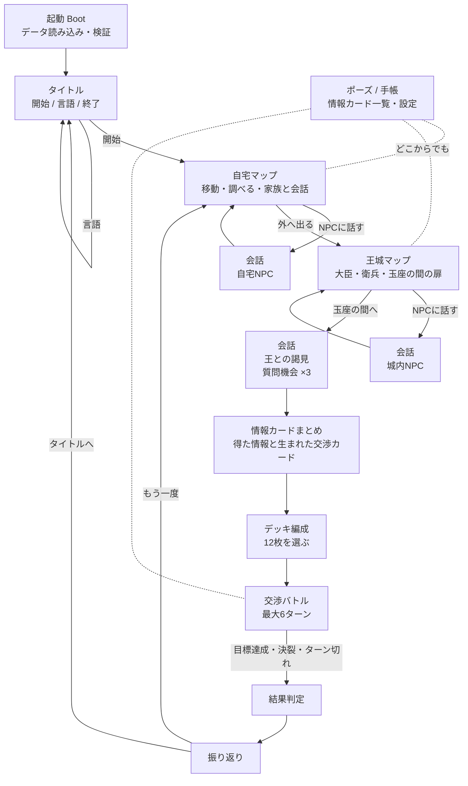

# Negotiation Quest 初期デモ（MVP）設計書

- 対象：初期デモ（企画書 §10「2 遊べる試作」相当）
- 元資料：`docs/Negotiation_Quest_初期版ゲーム企画書.docx`（以下「企画書」）と開発依頼文（以下「依頼」）
- ステータス：設計案（プログラム未着手）／作成日 2026-11-22

## 0. 表記ルール

各項目に出典を付けます。企画書にないことを確定事項として扱わないためです。

| タグ | 意味 |
|---|---|
| 【企画】 | 企画書に書かれている（確定した方向性） |
| 【依頼】 | 今回の開発依頼に書かれている |
| 【提案】 | 本書の設計提案。プレイテストで変えてよい |
| 【未決】 | 決める必要があるが、まだ決めていない。判断する人・タイミングが要る |

数値（ターン数・ゲージ上限・枚数など）は、とくに書いていない限りすべて【提案】の初期値です。

---

## 1. 企画書の要件整理

### 1.1 企画の中心仮説

> 交渉の知識を、正解当てではなく「状況を読み、選び、振り返る」遊びに変える。【企画】

- 判断基準：「知識を覚えたか」ではなく「状況に応じて知識を使えたか」をプレイで感じられるか【企画】
- 今回のデモで確かめること：**情報がカードになり、合意条件へつながるか**（§10 段階1の判断ポイント）と、**初見で交渉の面白さが伝わるか**（段階2の判断ポイント）【企画】

### 1.2 要件一覧（出典付き）

| # | 要件 | 出典 | 今回のデモでの扱い |
|---|---|---|---|
| R1 | 自宅から旅立ち、王に会う冒険の骨格 | 企画 §1、依頼 1–2 | 自宅 → 王城 → 王との謁見まで実装 |
| R2 | 通常モードは選択式で情報収集する。選択に正誤はなく、何を優先するかを表す | 企画 §5.1、依頼 3 | 実装 |
| R3 | 発見した情報がカードになる | 企画 §5.2、依頼 4 | 実装 |
| R4 | カード役割：質問／根拠の提示／共通利益の明示／条件交換／選択肢の拡張／信頼の回復 | 企画 §5.2 | 6種類すべてを最低1枚ずつ用意 |
| R5 | 相手の意図をターンごとに示す（拒絶・防御・譲歩・要求強化など） | 企画 §5.2 | 実装 |
| R6 | 相手の特性（時間重視・面子・損失回避など） | 企画 §5.2 | 王に2つ付与 |
| R7 | 隠れた事情（探索・対話で初めて分かる制約。条件設計を反転させる） | 企画 §5.2 | 1つ実装（このデモの核） |
| R8 | ランダムイベント | 企画 §5.2 | 【未決】MVPに入れるか（§3.6参照）。【提案】は1種類だけのストレッチ目標 |
| R9 | 勝利条件は相手の打倒ではなく、シナリオ固有の具体目標（期限内の協力獲得など） | 企画 §5.3、依頼 6 | 実装 |
| R10 | 理想の結果は双方に受け入れ可能な利益が残ること | 企画 §5.3 | 結果判定の評価軸にする |
| R11 | 振り返りは短く、説教調にしない。選択・相手の反応・ほかの方向性を示し、概念名は必要な範囲で添える。唯一の正解として扱わない | 企画 §7、依頼 7 | 実装 |
| R12 | クイズ型にしない | 企画 §7、依頼 | 設計全体の制約 |
| R13 | デッキ構築と相手の行動予測を組み合わせる | 企画 §5.2、依頼 | 実装 |
| R14 | 会話パートとカードバトルパートを明確に分離する | 依頼 | アーキテクチャで担保（§3.1） |
| R15 | 日本語・英語。表示文字列をロジックから分離する | 企画 §8、依頼 | 構造は必須。英語テキストをどこまで入れるかは【未決】（下記） |
| R16 | Godot 4 / GDScript / JSON・CSVのデータ駆動 | 企画 §9、依頼 | 実装 |
| R17 | デスクトップとHTML5を共通ロジックで出力。HTML5は早めに実機検証する | 企画 §9・§12・§13 | Webエクスポートでの起動を受け入れ基準に入れる |
| R18 | ライブAIを必須にしない／今回はAI APIに接続しない | 企画 §5.1、依頼 | 接続しない。ただし将来差し替えられる境界は残す（§3.1） |
| R19 | 仮素材でもゲーム画面として成立させる | 依頼 | プレースホルダー素材の規約を定める（§5） |
| R20 | 通常のRPG戦闘は含めない | 企画 §2 | 含めない |

### 1.3 企画書のMVP受け入れ基準（§13）との対応

| 企画書の基準 | 本デモでの担保方法 |
|---|---|
| 探索・対話・交渉・振り返りが途切れずに最後まで遊べる | 画面遷移（§4）を通しでテストする |
| 対話で得た**少なくとも2種類**の情報が、カードや勝利条件の選択に具体的な差を生む | 情報カード5種を用意し、うち2種で勝ち筋が変わるようにする（§3.3、§3.5） |
| 相手の意図表示を見て「次の手を考える」余地がある | 意図ごとに有効なカードと無駄になるカードを分ける（§3.4.4） |
| 勝利が明示された条件を満たす合意として理解できる | 交渉目標を画面に常時表示する |
| 選択の理由と交渉概念の接続を短く確認できる | 振り返り画面（§3.7） |
| 日英の両方で主要画面と代表シナリオが理解可能な品質で動く | 下記の未決事項 U1 |
| デスクトップとHTML5で同じ基本ループを起動・検証できる | 両方のエクスポートでのスモークテスト（§8） |

### 1.4 企画書と依頼の違い・あいまいな点

- **U1【未決】英語テキストの範囲**：依頼は「多言語化を考慮した構造」、企画書§13は「日英の両方で理解可能な品質で動く」と書いており、求める水準が違います。
  - 【提案】最初のプレイアブルは日本語のみで完成させ、英語は**全キーに仮訳を入れた状態**にします（言語切替とUI幅の確認用）。英語の品質レビューは中心仮説を確認した後に回します。
- **U2【未決】交渉相手**：依頼の流れ（王と会話 → 情報カード → 交渉）では、交渉相手が王なのか、王から依頼された別人物なのかが決まっていません。
  - 【提案】最初の代表シナリオは**王との交渉**にします。会話と交渉の因果が一つの場面で完結するので、検証したいことが見えやすいからです。
- **U3**：企画書のカード30〜40枚は初期版（2〜4時間）の規模です。デモでは約16〜20枚に絞ります【提案】。

---

## 2. MVP機能一覧

優先度：**Must** = これがないと検証できない／**Should** = 体験の質に効く／**Could** = 余裕があれば

| ID | 機能 | 優先度 | 出典 |
|---|---|---|---|
| F01 | タイトル画面（開始・言語切替・終了） | Must | 【提案】 |
| F02 | 自宅マップ：移動、調べる、NPC1人と短い会話、外に出る | Must | 【依頼】1 |
| F03 | 王城マップ：玉座の間へ移動、城内NPC1〜2人（任意の情報源） | Must | 【依頼】2、【企画】§6 |
| F04 | 会話システム：テキスト送り、話者名、選択肢、フラグ・条件分岐 | Must | 【企画】§5.1 |
| F05 | 質問機会の上限：聞ける回数に限りがあり、全部の情報は取れない | Must | 【提案】クイズ化を防ぐ中心ルール |
| F06 | 情報カード獲得の演出と「手帳」画面（獲得した情報の一覧） | Must | 【依頼】4 |
| F07 | デッキ編成画面：所持カードから決まった枚数を選ぶ | Must | 【依頼】デッキ構築 |
| F08 | 交渉バトル：議題、ゲージ、手札、AP、ターン制 | Must | 【企画】§5.2 |
| F09 | 相手の意図表示と、情報量による表示精度の変化 | Must | 【企画】§5.2 |
| F10 | 相手の特性（2つ）と隠れた事情（1つ） | Must | 【企画】§5.2 |
| F11 | 交渉目標の常時表示と達成判定（4段階の結果） | Must | 【企画】§5.3 |
| F12 | 振り返り画面：主要な判断3つ、相手の反応、別の方向性、概念名 | Must | 【企画】§7 |
| F13 | 判断ログ：会話と交渉での選択を記録し、振り返りに渡す | Must | 【提案】 |
| F14 | 日英切替（CSV翻訳、全テキストをキー化） | Must（構造）／Should（英文品質） | 【企画】§8 |
| F15 | HTML5エクスポートで基本ループが動く | Must | 【企画】§13 |
| F16 | もう一度遊ぶ（同じシナリオを最初から） | Should | 【提案】再プレイ差分の確認用 |
| F17 | 交渉ログ（このターンに何が起きたかの履歴） | Should | 【提案】理解の補助 |
| F18 | チュートリアル的な誘導（初回だけ説明を出す） | Should | 【提案】 |
| F19 | ランダムイベント1種 | Could | 【企画】§5.2／【未決】 |
| F20 | 自宅での小さな交渉（チュートリアル交渉） | Could | 【企画】§6「初期の小さな交渉」 |
| F21 | セーブ／ロード | 対象外 | 【提案】デモは15〜25分で、通しプレイを前提にする |
| F22 | 仲間システム、フィールド、ボス交渉 | 対象外 | 企画書では初期版の範囲。MVPには入れない |
| F23 | ハードモード（自由入力） | 対象外 | 【企画】通常モード完成後に決める |

想定プレイ時間：15〜25分【提案】

---

## 3. ゲームシステム詳細設計

### 3.1 アーキテクチャ方針【提案】

```
[探索 Field] ──会話開始──▶ [会話 Dialogue] ──情報カード──▶ [GameState(Run)]
                                                            │
                         [デッキ編成] ◀──所持カード─────────┘
                              │ デッキ
                              ▼
                      [交渉 Negotiation] ──結果・ログ──▶ [結果判定] ──▶ [振り返り]
```

- **会話と交渉の接点はデータ1つだけにする**（R14）：会話システムは `RunState`（フラグ、情報カード、初期信頼、判断ログ）に書き込み、交渉システムは開始時にそれを読むだけです。お互いを直接参照しません。
- **ロジックと表示を分ける**：会話エンジンと交渉エンジンは Node に依存しない `RefCounted` クラスにします。入力（カードを出す、選択肢を選ぶ）を受け取り、イベント列（`[{type:"gauge_changed",...}]`）を返します。シーン側はそのイベント列を演出するだけです。
  - これで、ヘッドレスでのユニットテスト、自動プレイによるバランス検証、将来のAI会話への差し替え（会話エンジンのインターフェースを差し替える）が可能になります。
- **乱数はすべてシード付き**にします（`RandomNumberGenerator` を RunState が所有）。テストを再現でき、バグも再現できるようにするためです。

### 3.2 代表シナリオ「王との謁見」【提案】

企画書§14では「各シナリオの具体的な物語・人物・条件」は【未決】です。以下は**検証用の仮シナリオ**で、固有名詞もすべて仮のものです。

**状況**：王は主人公に魔王の動向を探る旅を命じる。主人公には旅の支えが必要だが、王にもすぐには明かせない事情がある。

| 要素 | 内容 |
|---|---|
| 主人公の目標 | 旅に必要な支えを王から引き出す |
| 議題 | ①旅の支度（資金）②同行者 ③出発の期限 |
| 王の表の立場 | 「すぐに発て。支度金は十分に出す（つもりの口ぶり）。同行者は出せぬ」 |
| 王の利害 | 早く動いてほしい／大臣の前で面子を保ちたい／国の安寧 |
| 特性 | **時間を重視する**、**面子を守りたい**（企画書の例から2つ） |
| 隠れた事情 | **国庫が逼迫している**。資金を強く求めるほど王は面子のために拒む。分かれば「王の紹介状（商人への信用状）」という第三の選択肢が開ける |
| 交渉目標（勝利条件） | 6ターン以内に、3つの議題のうち**2つ以上で合意**し、交渉の終わりに**信頼3以上**を保つ |
| 双方の利益 | 王：早い出発と定期報告／主人公：紹介状と同行者 |

**この仮シナリオを選ぶ理由**

- 隠れた事情が条件設計を反転させる（「お金をもっと」→「お金以外で同じ効果を」）という企画書R7の要件を1回で体験できる。
- 王の目的（急いでほしい）とプレイヤーの譲歩材料（早く発つ）がかみ合い、相互利益の解がある。
- 会話で何を聞いたかによって、交渉の正面突破ルートと迂回ルートがはっきり分かれる。

### 3.3 会話・情報収集システム

#### 3.3.1 基本ルール

- 会話はノードのグラフで表します（テキストノード／選択肢ノード／分岐ノード／効果ノード）。【提案】
- 選択肢には**姿勢タグ**を付けます：`rapport`（関係を築く）／`probe`（制約を尋ねる）／`assert`（主張する）／`expand`（第三の選択肢を探る）。企画書§5.1の例に対応しています。正誤は持ちません。【企画】の考え方を【提案】で形にしたものです。
- **質問機会（Inquiry）**：王との謁見では、王が「ほかに何かあるか」と問う場面が3回あり、そのたびに3〜4つの方向から1つを選びます。1回のプレイで取れる情報は5種のうち2〜3種です。【提案】
  - → 「全部正解を選ぶ」遊びにならず、「何を優先して聞くか」の選択になります（R12）。
- 選択の結果は、情報カード、交渉開始時の信頼・緊張、フラグ、判断ログに反映されます。
- 自宅と城内のNPCは、王に何を聞くべきかの**手がかり**をくれます（例：大臣が城の倉の話でため息をつく）。探索した人ほど質問機会を有効に使えます。【提案】

#### 3.3.2 情報カード（Info Card）と交渉カードの関係

- **情報カード**：知った事実。手帳に記録される。
- **交渉カード**：交渉中に使う手札。
- 1枚の情報カードは、次のどれか（または複数）を起こします【提案】：
  1. 交渉カードを**追加**する
  2. 既存の交渉カードを**強化**する
  3. 相手について**知っている状態**にする（特性の公開、意図表示の精度アップ、隠れた事情の公開）

| 情報カード（仮） | 入手先 | 効果 | 交渉への影響 |
|---|---|---|---|
| 王の焦り | 王に「なぜ急ぐのか」を尋ねる（probe） | 特性「時間重視」を公開。条件交換「迅速な出発を約束」を追加 | 王の焦りを譲歩材料に変えられる |
| 大臣のため息 | 城内の大臣と話す → 王に倉のことを尋ねる | 隠れた事情「国庫逼迫」を公開。選択肢の拡張「紹介状の提案」を追加 | **迂回ルートが開く（核）** |
| 騎士の志願 | 城内の衛兵／自宅NPC → 王に同行者の話をする | 根拠の提示「志願者がいる」を追加 | 同行者の議題が進めやすくなる |
| 先王の誓い | 王に国の昔話を聞く（rapport） | 共通利益「王国の安寧」を強化。初期信頼+1 | 拒絶の意図に強くなる |
| 王の口癖 | 自宅NPCの昔話＋王への rapport 選択 | 意図表示の精度をLv2に上げる | 行動予測が楽になる |

- MVP受け入れ基準「2種類以上の情報が具体的な差を生む」は、**大臣のため息**（勝ち筋が変わる）と**王の口癖**（予測の精度が変わる）で担保します。

### 3.4 交渉カードバトル

#### 3.4.1 場の要素【提案】

| 要素 | 範囲 | 意味 |
|---|---|---|
| 議題（Issue） | 3つ。それぞれ進行度 0〜必要値（例：3〜5） | 必要値に届くと「合意」。企画書の「合意への進行」 |
| 信頼（Trust） | 0〜10。初期値は会話で決まる（基本3） | 高いほど相手が譲歩しやすい。終了時の条件にも使う |
| 緊張（Tension） | 0〜10 | 高いと拒絶しやすい。**10で決裂（即敗北）** |
| 譲歩余力（Leeway） | 主人公側のリソース。初期3 | 条件交換カードで支払う。使いすぎると結果評価が下がる。企画書の「譲歩余力」 |
| 発言力（AP） | 毎ターン3 | カードを出すコスト |
| 手札 | 毎ターン5枚まで引く | — |
| ターン | 6 | 期限。企画書「期限内の協力獲得」 |

議題は**状態**も持ちます：`open`（交渉中）／`capped`（隠れた事情のため上限がある）／`agreed`（合意）／`transformed`（別の形に変わった。例：資金 → 紹介状）。

#### 3.4.2 ターンの流れ【提案】

1. **ターン開始**：手札を5枚まで引く。APを3に回復。相手の**今ターンの意図**を表示する。
2. **プレイヤー行動**：APの範囲でカードを出す。対象の議題を選ぶ。効果はすぐに反映される。
3. **ターン終了**：相手が意図どおりに行動する（意図の効果を解決）。
4. **特性の判定**：例「時間重視」— このターンにどの議題も進まなければ緊張+1。
5. **終了判定**：目標達成／決裂／ターン切れを確認する。
6. 相手が次の意図を決める（重み付き抽選、§3.4.5）。

ゲームの手触りの基準は「相手の予告を見て、手札とAPをどう割り振るか」です。ジャンル慣習として意図の予告表示を使っていますが、特定作品のルール・見た目は再現しません。

#### 3.4.3 カード役割と効果（初期値）

企画書§5.2の6役割をカードの「型」にします。効果の数値はすべて【提案】です。

| 型 | 基本効果 | 意図との相性 |
|---|---|---|
| 質問 Question | 隠れた事情や次の意図を探る。未公開の情報を1つ公開する（または次の意図を一段詳しく見る）。緊張-1 | **防御**のときに強い |
| 根拠の提示 Evidence | 議題の進行+2 | **防御**のときは半減。緊張が高いときは面子の特性で緊張+2 |
| 共通利益の明示 Common Ground | 信頼+1、緊張-1 | **拒絶**を打ち消す |
| 条件交換 Trade | 譲歩余力を1払い、議題の進行+3 | **譲歩**のときは効果2倍。**要求強化**に応える |
| 選択肢の拡張 Expand | 議題を別の形に変える（`capped` を解除するなど） | **要求強化**にも応えられる |
| 信頼の回復 Repair | 信頼+2。手札を1枚引き直す | 決裂寸前の立て直し |

**デッキ構成（デモ）【提案】**

- 基本カード10枚（全員が持つ）＋情報由来のカード最大5枚＋自宅や城で拾う汎用カード数枚。
- デッキ編成では**所持カードから12枚を選ぶ**。全部入れられないので、何を軸に戦うかを決める判断が生まれます。
- 【未決】U4：デッキ編成を「捨てる枚数を選ぶ」形にするか、「12枚を選ぶ」形にするか。初回プレイの迷いやすさで決めます。

#### 3.4.4 相手の意図（Intent）

企画書の4種類をそのまま採用し、それぞれにプレイヤーの対応策を用意します。

| 意図 | ターン終了時の効果（何もしなかった場合） | 有効な対応 |
|---|---|---|
| 拒絶 Reject | 最も進んでいる議題の進行-2、信頼-1 | 共通利益の明示、信頼の回復 |
| 防御 Guard | 効果はないが、このターンは根拠の効果が半減 | 質問で探る（このターンは探索に使う） |
| 譲歩 Concede | 指定の議題が+1 | **攻めどき**：条件交換が2倍 |
| 要求強化 Demand | 王が条件を追加する（例：「明日出発せよ」）。応えないと緊張+2 | 条件交換で応じる、選択肢の拡張で受け流す |

**意図表示の精度（情報が予測を変える）**【提案】

| レベル | 表示内容 | 条件 |
|---|---|---|
| Lv1 | 意図の種類だけ（例：「拒絶」） | 基本 |
| Lv2 | 種類＋対象の議題＋強さ | 情報カード「王の口癖」、または質問カードで一時的に |
| Lv0（特殊） | 「？」 | 緊張8以上で、王が本心を隠す |

#### 3.4.5 相手AI（意図の決め方）【提案】

- 状態に応じた**重み付き抽選**にします（シード付き乱数）。重みの表は相手データ（JSON）に置きます。
- 例：緊張が高い → 拒絶が出やすい／信頼が高い → 譲歩が出やすい／特性「時間重視」→ 後半ほど要求強化が出やすい。
- 完全なランダムにはせず、**同じ意図は3回連続しない**などの制約を入れ、読み合える範囲に保ちます。

#### 3.4.6 隠れた事情の処理

- 「国庫逼迫」が未公開の間、資金の議題は `capped`（進行2までしか進まない）。根拠を重ねても上限で止まり、緊張が上がっていきます。ここで「何かがおかしい」と感じてもらうのが狙いです。
- 公開されるのは次のどちらかです：会話で「大臣のため息」を入手する／交渉中に質問カードで探る（防御中なら確実、それ以外は確率で公開）。
- 公開後は、選択肢の拡張「紹介状の提案」で資金の議題が `transformed` →「紹介状」（必要値が低く、王の面子も守れる）に変わります。
- **会話で知っていた人は迂回ルートを最初から計画でき、知らなかった人も交渉中に気づける**。こうして情報を「正解の鍵」ではなく「有利さ」として扱います（R12）。

#### 3.4.7 カード効果の表現

カード効果はコードに直接書かず、JSONの**効果オペレーション列**で表します（§6.3）。エンジン側は、`add_progress`、`add_gauge`、`reveal`、`transform_issue`、`draw`、`spend_leeway`、`modify_if_intent` などのオペレーションを解釈するだけにします。【提案】

### 3.5 結果判定

【企画】勝利は条件を満たす合意。双方の利益を重視する。
【提案】次の4段階で判定します。

| 結果 | 条件（初期案） |
|---|---|
| 双方納得の合意 | 2議題以上で合意＋信頼6以上＋譲歩余力を1以上残す |
| 合意 | 2議題以上で合意＋信頼3以上 |
| 部分合意 | 1議題で合意、またはターン切れでも信頼3以上 |
| 決裂 | 緊張10、または議題の合意0でターン切れ |

- 結果画面には「何を得たか」（例：紹介状・騎士1名・出発は3日後）を**物語の言葉**で出します。数値だけで終わらせません。
- 判定条件はシナリオJSONに置き、コードを変えずに調整できるようにします。
- 【未決】U5：「決裂」をゲームオーバーとして扱うか、物語上は先へ進めるか（デモは振り返りまで進めることを【提案】します。振り返りこそ学びの場面だからです）。

### 3.6 ランダム要素【未決】

- 企画書では初期版にランダムイベントを含めますが、MVPの受け入れ基準には書かれていません。
- 【提案】MVPのランダム要素は**山札の順番**と**相手の意図の抽選**だけにします。イベントは「伝令が来る：残りターン-1、王の要求強化の確率が上がる」の1種類を Could として用意し、ゲーム内のフラグで有効・無効を切り替えます。

### 3.7 振り返り

【企画】短く、説教調にしない／選択・相手の反応・ほかの方向性を示す／概念名は必要な範囲で添える／唯一の正解として扱わない。

**画面構成【提案】**

1. **結果のひとこと**（例：「王は紹介状を書き、騎士を一人つけた」）
2. **あなたの判断 3つ**：判断ログから「影響の大きかった判断」を3つ選んで表示する
   - 例：「謁見で、資金の額より王の事情を先に尋ねた」→ 王の反応 → 交渉への影響
3. **ほかに取れた方向**：選ばなかった姿勢タグのうち1つを示す（「もし最初から資金を強く求めていたら…」）
4. **概念タグ**：企画書§7の例から、関係する概念を1〜2個だけ添える（例：「利害と立場の違い」「選択肢の拡張」）
5. 「もう一度遊ぶ」／「タイトルへ」

**判断の選び方【提案】**：判断ログの各エントリに `impact`（結果への影響度）を記録し、上位3件を表示します。影響度はシナリオデータで「この判断はこの議題・この公開に効いた」と著者が定義します。

**文章のルール**：評価語（正しい・間違い・失敗）を使わない。「〜した」「〜だった」「〜という道もあった」の形で書きます。

---

## 4. 画面遷移図



- 自宅 → 王城は、まずマップ切替（フェード）で直接つなぎます【提案】。町やフィールドはMVPに入れません。
- 【未決】U6：探索の操作方式。
  - 【提案】は**見下ろし型の歩行＋調べる**です。「冒険を始める」手触りがあり、仮素材でもゲーム画面として成立させやすいからです。
  - 工数を減らしたい場合は「場所をクリックして移動するメニュー型」にします。どちらにしても、会話と交渉の設計には影響しません。

---

## 5. Godot ディレクトリ構成【提案】

```
negotiation-quest/
├── project.godot
├── docs/
│   ├── Negotiation_Quest_初期版ゲーム企画書.docx
│   └── DESIGN_MVP.md
├── data/                          # ゲームデータ（JSON）。ロジックに文章を含めない
│   ├── cards/cards.json           # 交渉カード定義
│   ├── info_cards/info_cards.json # 情報カード定義
│   ├── opponents/king.json        # 相手：特性・意図の重み・隠れた事情
│   ├── scenarios/sc01_king_audience.json  # 議題・目標・結果判定・振り返り定義
│   ├── dialogues/                 # 会話グラフ
│   │   ├── home_family.json
│   │   ├── castle_minister.json
│   │   ├── castle_guard.json
│   │   └── king_audience.json
│   ├── concepts/concepts.json     # 交渉概念（振り返り用）
│   └── schema/                    # JSONスキーマ（検証用。開発時のみ）
├── localization/
│   ├── strings_ui.csv             # keys,ja,en （UI）
│   ├── strings_dialogue.csv       # 会話文
│   ├── strings_cards.csv          # カード名・説明
│   └── strings_reflection.csv     # 振り返り文
├── scenes/
│   ├── boot/Boot.tscn
│   ├── title/Title.tscn
│   ├── field/Home.tscn
│   ├── field/Castle.tscn
│   ├── field/Player.tscn
│   ├── dialogue/DialogueBox.tscn         # 会話UI（オーバーレイ）
│   ├── cards/InfoCardSummary.tscn
│   ├── cards/DeckBuilder.tscn
│   ├── negotiation/NegotiationBattle.tscn
│   ├── negotiation/CardView.tscn
│   ├── negotiation/IntentView.tscn
│   ├── result/Result.tscn
│   ├── reflection/Reflection.tscn
│   └── common/Notebook.tscn, PauseMenu.tscn
├── scripts/
│   ├── autoload/
│   │   ├── DataRegistry.gd        # JSON読み込み・ID参照・検証
│   │   ├── RunState.gd            # 1プレイ分の状態（フラグ・カード・ログ・乱数）
│   │   ├── SceneRouter.gd         # 画面遷移の一元化
│   │   └── Settings.gd            # 言語・音量など
│   ├── core/                      # Node非依存の純ロジック（テスト対象）
│   │   ├── dialogue/DialogueEngine.gd, DialogueCondition.gd
│   │   ├── negotiation/NegotiationEngine.gd
│   │   ├── negotiation/NegotiationState.gd
│   │   ├── negotiation/EffectResolver.gd
│   │   ├── negotiation/IntentPlanner.gd
│   │   ├── negotiation/OutcomeEvaluator.gd
│   │   └── reflection/ReflectionBuilder.gd
│   └── ui/                        # シーンに付くスクリプト（表示・入力のみ）
├── assets/
│   ├── placeholder/               # 仮素材（命名規則: ph_<用途>_<名前>.png）
│   ├── fonts/                     # 日英対応フォント（例: Noto Sans JP）
│   └── audio/
├── tests/
│   ├── unit/                      # エンジンの単体テスト
│   ├── data/                      # データ整合性テスト
│   └── sim/                       # 自動プレイ（バランス確認）
└── tools/                         # データ検証・翻訳キー抽出などの補助スクリプト
```

**構成のポイント**

- `scripts/core/` は `extends RefCounted` だけで書き、シーンツリーなしで動かせるようにします（テスト、シミュレーション、将来のAI差し替えのため）。
- 文字列は `tr("key")` で引きます。Godot 4 は CSV を Translation リソースとしてインポートできるので、追加の仕組みはほぼ不要です。
- 画面サイズは 1280×720、ストレッチは `canvas_items` / `expand`。デスクトップとWebで同じレイアウトを使います。
- 【未決】U7：テストフレームワーク（GUT か gdUnit4 か）。【提案】は GUT です（GDScriptだけで完結し、CLIでヘッドレス実行しやすいため）。

---

## 6. データ設計【提案】

### 6.1 共通ルール

- **IDとテキストキーを分ける**：データには表示文字列を書かず、翻訳キーだけを書きます（例：`"name_key": "card.trade_quick_departure.name"`）。
- IDは `snake_case`、英数字のみ。テキストキーは `<種別>.<id>.<項目>` の形にします。
- 全ファイルに `"schema_version": 1` を入れます。
- 起動時に DataRegistry が参照の整合性（存在しないIDの参照や、翻訳キーの抜け）を検証します。デバッグビルドで不整合があれば起動を止めます。

### 6.2 交渉カード `data/cards/cards.json`

```json
{
  "schema_version": 1,
  "cards": [
    {
      "id": "trade_quick_departure",
      "type": "trade",
      "cost": 1,
      "name_key": "card.trade_quick_departure.name",
      "desc_key": "card.trade_quick_departure.desc",
      "target": "issue",
      "effects": [
        { "op": "spend_leeway", "value": 1 },
        { "op": "add_progress", "value": 3 },
        { "op": "modify_if_intent", "intent": "concede", "multiply": 2 },
        { "op": "answer_demand", "demand_tag": "departure" }
      ],
      "concept_ids": ["trade_off", "priority"],
      "source": "info:king_hurry",
      "art": "res://assets/placeholder/ph_card_trade.png"
    },
    {
      "id": "expand_letter_of_credit",
      "type": "expand",
      "cost": 2,
      "name_key": "card.expand_letter_of_credit.name",
      "desc_key": "card.expand_letter_of_credit.desc",
      "target": "issue",
      "requires": [{ "revealed": "hidden_treasury" }],
      "effects": [
        { "op": "transform_issue", "from": "funds", "to": "letter_of_credit" },
        { "op": "add_gauge", "gauge": "tension", "value": -1 }
      ],
      "concept_ids": ["expand_options", "interest_vs_position"],
      "source": "info:minister_sigh"
    }
  ]
}
```

### 6.3 効果オペレーション（エンジンが解釈する語彙）

| op | 引数 | 説明 |
|---|---|---|
| `add_progress` | value, issue?（省略時は選んだ議題） | 議題の進行を増減する |
| `add_gauge` | gauge(trust/tension/leeway), value | ゲージを増減する |
| `spend_leeway` | value | 譲歩余力を使う（足りないと出せない） |
| `reveal` | target(hidden/trait/intent_detail), id? | 情報を公開する |
| `reveal_chance` | target, chance, guaranteed_if_intent? | 確率で公開する |
| `transform_issue` | from, to | 議題を別の形にする |
| `cancel_intent` | intent | 指定した意図の効果を打ち消す |
| `answer_demand` | demand_tag | 要求強化に応える |
| `modify_if_intent` | intent, multiply / add | 意図による効果の補正 |
| `draw` | value | カードを引く |

条件は `requires: [{ "revealed": id } | { "flag": id } | { "gauge": "trust", "gte": 5 }]` の形で共通化し、会話・カード・結果判定で同じ評価器を使います。

### 6.4 情報カード `data/info_cards/info_cards.json`

```json
{
  "schema_version": 1,
  "info_cards": [
    {
      "id": "minister_sigh",
      "name_key": "info.minister_sigh.name",
      "desc_key": "info.minister_sigh.desc",
      "grants": [
        { "kind": "add_card", "card_id": "expand_letter_of_credit" },
        { "kind": "reveal", "target": "hidden", "id": "hidden_treasury" }
      ],
      "concept_ids": ["information_gathering"]
    },
    {
      "id": "king_habit",
      "grants": [{ "kind": "intent_visibility", "level": 2 }]
    }
  ]
}
```

### 6.5 相手 `data/opponents/king.json`

```json
{
  "schema_version": 1,
  "id": "king",
  "name_key": "char.king.name",
  "portrait": "res://assets/placeholder/ph_portrait_king.png",
  "traits": [
    { "id": "time_pressure", "rule": { "on": "turn_end_no_progress", "effects": [{ "op": "add_gauge", "gauge": "tension", "value": 1 }] } },
    { "id": "save_face", "rule": { "on": "card_played", "card_type": "evidence", "when": [{ "gauge": "tension", "gte": 5 }], "effects": [{ "op": "add_gauge", "gauge": "tension", "value": 2 }] } }
  ],
  "hidden": [
    { "id": "hidden_treasury", "caps_issue": { "issue": "funds", "max": 2 } }
  ],
  "intent_table": {
    "base": { "reject": 2, "guard": 3, "concede": 2, "demand": 3 },
    "modifiers": [
      { "when": [{ "gauge": "tension", "gte": 6 }], "add": { "reject": 4 } },
      { "when": [{ "gauge": "trust", "gte": 6 }], "add": { "concede": 3 } },
      { "when": [{ "turn": "gte", "value": 4 }], "add": { "demand": 2 } }
    ],
    "max_repeat": 2
  },
  "intents": {
    "reject": { "effects": [{ "op": "add_progress", "issue": "@most_advanced", "value": -2 }, { "op": "add_gauge", "gauge": "trust", "value": -1 }], "countered_by": ["common_ground", "repair"] },
    "guard":  { "modifiers": [{ "card_type": "evidence", "multiply": 0.5 }] },
    "concede":{ "effects": [{ "op": "add_progress", "issue": "@target", "value": 1 }], "modifiers": [{ "card_type": "trade", "multiply": 2 }] },
    "demand": { "demand_pool": ["departure", "report"], "unanswered": [{ "op": "add_gauge", "gauge": "tension", "value": 2 }] }
  }
}
```

### 6.6 シナリオ `data/scenarios/sc01_king_audience.json`

```json
{
  "schema_version": 1,
  "id": "sc01_king_audience",
  "opponent": "king",
  "title_key": "scenario.sc01.title",
  "goal_key": "scenario.sc01.goal",
  "rules": { "turns": 6, "ap": 3, "hand_size": 5, "deck_size": 12 },
  "initial": { "trust": 3, "tension": 2, "leeway": 3 },
  "issues": [
    { "id": "funds", "name_key": "issue.funds", "required": 4 },
    { "id": "letter_of_credit", "name_key": "issue.letter_of_credit", "required": 2, "hidden_until_transform": true },
    { "id": "companion", "name_key": "issue.companion", "required": 4 },
    { "id": "deadline", "name_key": "issue.deadline", "required": 3 }
  ],
  "outcomes": [
    { "id": "mutual",  "when": [{ "agreed_count": "gte", "value": 2 }, { "gauge": "trust", "gte": 6 }, { "gauge": "leeway", "gte": 1 }], "text_key": "outcome.sc01.mutual" },
    { "id": "agreed",  "when": [{ "agreed_count": "gte", "value": 2 }, { "gauge": "trust", "gte": 3 }], "text_key": "outcome.sc01.agreed" },
    { "id": "partial", "when_any": [[{ "agreed_count": "gte", "value": 1 }], [{ "gauge": "trust", "gte": 3 }]], "text_key": "outcome.sc01.partial" },
    { "id": "breakdown", "default": true, "text_key": "outcome.sc01.breakdown" }
  ],
  "reflection": {
    "moments": [
      { "id": "asked_before_demanding", "detect": { "log_tag": "probe", "before": "assert", "phase": "audience" }, "impact": 3, "text_key": "refl.sc01.asked_first", "concept_ids": ["interest_vs_position"] },
      { "id": "used_letter", "detect": { "card_played": "expand_letter_of_credit" }, "impact": 3, "text_key": "refl.sc01.letter", "alt_key": "refl.sc01.letter_alt", "concept_ids": ["expand_options"] }
    ]
  }
}
```

### 6.7 会話 `data/dialogues/king_audience.json`

```json
{
  "schema_version": 1,
  "id": "king_audience",
  "start": "n_intro",
  "nodes": {
    "n_intro": { "type": "line", "speaker": "king", "text_key": "dlg.king.intro", "next": "n_inquiry_1" },
    "n_inquiry_1": {
      "type": "choice",
      "inquiry": true,
      "choices": [
        { "text_key": "dlg.king.q_why_hurry", "stance": "probe",  "effects": [{ "grant_info": "king_hurry" }], "next": "n_hurry" },
        { "text_key": "dlg.king.q_old_vow",   "stance": "rapport","effects": [{ "grant_info": "old_vow" }, { "trust": 1 }], "next": "n_vow" },
        { "text_key": "dlg.king.q_treasury",  "stance": "probe",  "requires": [{ "flag": "talked_minister" }], "effects": [{ "grant_info": "minister_sigh" }, { "tension": 1 }], "next": "n_treasury" },
        { "text_key": "dlg.king.q_demand_gold","stance": "assert", "effects": [{ "tension": 1 }, { "flag": "demanded_gold" }], "next": "n_gold" }
      ]
    }
  }
}
```

- 会話のすべての選択は、RunStateの判断ログに `{phase, node, choice_index, stance, effects}` として自動で記録されます。

### 6.8 翻訳 `localization/strings_cards.csv`

```
keys,ja,en
card.trade_quick_departure.name,迅速な出発を約束,Promise a Swift Departure
card.trade_quick_departure.desc,譲歩余力1を払い、議題を3進める。相手が譲歩の構えなら2倍。,Spend 1 Leeway. Advance an issue by 3. Doubled if they lean toward conceding.
```

- 数値はテキストに直接書かず、`{value}` のようなプレースホルダーを使います（`tr(key).format({...})`）。

### 6.9 RunState（実行時の状態。保存はしない）

```
seed, flags{}, info_cards[], owned_cards[], deck[],
intent_visibility, revealed[], initial_mods{trust, tension},
decision_log[ {phase, kind, id, stance/card_type, turn?, intent_at_time?, impact_refs[]} ],
battle_result{outcome_id, agreed_issues[], gauges{}, turns_used}
```

---

## 7. 実装タスク一覧【提案】

サイズ：S＝半日程度／M＝1〜2日／L＝3日以上（体制が決まっていないので、目安の相対値です）

### M0 プロジェクト基盤
| # | タスク | サイズ | 完了条件 |
|---|---|---|---|
| T01 | Godot 4 プロジェクト作成、画面設定、ディレクトリ作成、Git初期化 | S | 空シーンがデスクトップで起動する |
| T02 | **HTML5エクスポートの早期検証**（空プロジェクト＋日本語フォント） | S | ブラウザで日本語が表示される |
| T03 | Autoload（DataRegistry / RunState / SceneRouter / Settings）の雛形 | S | シーン遷移が1か所から呼べる |
| T04 | テストフレームワーク導入とCLI実行 | S | ヘッドレスでダミーテストが通る |

### M1 データとコアロジック（画面なし）
| # | タスク | サイズ | 完了条件 |
|---|---|---|---|
| T05 | JSONローダーと参照整合性チェック | M | 壊れたデータで分かりやすいエラーが出る |
| T06 | 条件評価器（flag/gauge/revealed など）の共通化 | S | 単体テストが通る |
| T07 | NegotiationState と EffectResolver（op語彙） | M | 全opの単体テストが通る |
| T08 | IntentPlanner（重み付き抽選、連続制限、シード） | M | 同じシードで同じ結果になる |
| T09 | NegotiationEngine（ターン進行、特性、隠れた事情、終了判定） | L | テキストだけで1戦を最後まで回せる |
| T10 | OutcomeEvaluator | S | 4段階すべてのテストが通る |
| T11 | **自動プレイシミュレーター**（ランダム戦略と単純な戦略） | M | 1000戦の勝率分布が出力される |

### M2 会話と情報収集
| # | タスク | サイズ | 完了条件 |
|---|---|---|---|
| T12 | DialogueEngine（ノードグラフ、選択肢、条件、効果、ログ） | M | 単体テストが通る |
| T13 | 会話UI（文字送り、話者名、顔、選択肢、質問機会の残り表示） | M | 王との謁見を最後まで読める |
| T14 | 情報カード獲得の演出と手帳画面 | M | 獲得した情報と生まれたカードが見える |
| T15 | 会話データ執筆（自宅・大臣・衛兵・王）※日本語 | L | 情報5種すべてに入手ルートがある |

### M3 探索
| # | タスク | サイズ | 完了条件 |
|---|---|---|---|
| T16 | プレイヤー移動と調べる処理（U6の決定後） | M | 自宅とNPCに話しかけられる |
| T17 | 自宅マップと王城マップ（仮タイル） | M | 自宅 → 城 → 玉座の間まで行ける |

### M4 交渉バトルUI
| # | タスク | サイズ | 完了条件 |
|---|---|---|---|
| T18 | デッキ編成画面 | M | 12枚を選んで開始できる |
| T19 | バトル画面のレイアウト（議題、ゲージ、手札、意図、目標表示） | L | エンジンのイベント列を表示できる |
| T20 | カード操作（選ぶ → 対象の議題 → 実行）とキャンセル | M | マウスとキーボードで操作できる |
| T21 | 意図表示（Lv0/1/2）と、意図の解決演出 | M | 何が起きたかがログと演出で分かる |
| T22 | 結果判定画面 | S | 得たものが物語の言葉で表示される |

### M5 振り返りと通し
| # | タスク | サイズ | 完了条件 |
|---|---|---|---|
| T23 | ReflectionBuilder（ログ → 上位3件の判断・別の方向・概念） | M | 単体テストが通る |
| T24 | 振り返り画面と、もう一度遊ぶ処理 | M | タイトルから振り返りまで通しで遊べる |
| T25 | 振り返り文の執筆（説教調にしないルールでのレビュー） | M | 全モーメントに本文と別の方向の文がある |

### M6 多言語・Web・調整
| # | タスク | サイズ | 完了条件 |
|---|---|---|---|
| T26 | 翻訳キーの抽出・抜け検出ツール | S | 抜けているキーが一覧で出る |
| T27 | 英語の仮訳を全キーに入れ、UIのはみ出しを確認 | M | 英語で通しプレイしても表示が崩れない |
| T28 | HTML5ビルドで通しプレイ | S | 主要ブラウザ（Chrome / Firefox / Safari）で完走できる |
| T29 | バランス調整（シミュレーター＋手触り） | M | §8.3 の目標範囲に入る |
| T30 | 社内プレイテストと改善 | M | §8.4 の観察項目で記録する |

**推奨の着手順**：T01–T04 → **T05–T11（交渉が画面なしで面白いかを先に見る）** → T12–T15 → T18–T22 → T23–T25 → T16–T17 → T26–T30
探索（M3）を後に回すのは、検証の中心が会話 → 交渉 → 振り返りだからです。探索がなくても、デバッグ用の直行メニューで謁見から始められるようにします。

---

## 8. テスト方針

### 8.1 自動テスト（単体）
- 対象は `scripts/core/` のみ（UIは対象外）。
- 必須のケース：
  - 各効果opの増減と、上下限のクランプ
  - 意図ごとの補正（防御で根拠が半減、譲歩で条件交換が2倍）
  - 隠れた事情の上限 → 公開 → 議題の変化
  - 特性による発動（進行なしで緊張+1、面子）
  - 終了判定（緊張10での決裂、ターン切れ、目標達成）
  - 結果4段階の境界値
  - 同じシードでの再現性
  - 会話の条件付き選択肢、質問機会の消費、判断ログの記録

### 8.2 データテスト
- 全JSONの読み込み、スキーマ検証、ID参照の整合性
- 全テキストキーが ja / en のCSVに存在するか（en は仮訳でもよい）
- 全情報カードに会話での入手ルートがあるか、全カードが入手可能か（到達可能性チェック）

### 8.3 シミュレーションテスト（バランス）【提案の目標値】
| 条件 | 目標 |
|---|---|
| 情報なし・ランダムに出す | 合意以上 10〜25% |
| 情報なし・単純な貪欲戦略 | 合意以上 40〜55%（正面突破は可能だが苦しい） |
| 「大臣のため息」あり・貪欲戦略 | 合意以上 65〜80%（情報の価値が数字に出る） |
| どの条件でも | 双方納得の合意は 25% 以下（上手く遊んだ人へのご褒美） |
| 平均ターン数 | 4.5〜6（期限が意味を持つ） |

数値が目標から外れた場合は、まずデータ（JSON）を調整し、ルールは最後に変えます。

### 8.4 プレイテスト（人による検証）
企画書§13の基準を観察項目にします。
- 説明なしで初見の人が通しで遊べるか（どこで止まったか）
- 「この情報があったから、こう戦った」と**本人が言葉にできるか**
- 意図を見てカードを選び直す行動が出るか（手札を一度見てから決め直す、など）
- 「勝つ」ではなく「条件を満たす」と理解しているか（終了後に「何が目標でしたか」と聞く）
- 振り返りを説教と感じたか／次に試したいことがあるか
- クイズだと感じたか（「正解を探していた」という発言を記録）
- 2回目のプレイで別の質問を選んだか

### 8.5 プラットフォーム・ローカライズ
- マイルストーンごとに、デスクトップ（macOS / Windows）と HTML5 で起動と通しのスモークテストを行う
- HTML5：初回読み込み時間、フォントの表示、マウス・キーボード入力、タブを切り替えて戻ったときの挙動、音声の自動再生制限
- 英語表示：カード説明のはみ出し、ボタン幅、改行（日本語の禁則処理と英語の単語折り返し）

---

## 9. 未決事項一覧

| ID | 未決事項 | 本書の暫定案 | 決めるタイミング・判断材料 |
|---|---|---|---|
| U1 | MVPで英語テキストをどこまで入れるか | 全キーに仮訳を入れ、品質レビューは後回し | 中心仮説を確認した後 |
| U2 | 代表シナリオの交渉相手・物語・固有名詞 | 王との謁見（仮）。企画書§14でも未決 | 設計レビュー時 |
| U3 | デモのカード枚数 | 所持16〜20枚／デッキ12枚 | シミュレーターとプレイテスト |
| U4 | デッキ編成の形式（選ぶか、外すか） | 12枚を選ぶ | 初回プレイテスト |
| U5 | 決裂時の扱い | 振り返りまで進める | 物語設計時 |
| U6 | 探索の操作方式（歩行か、メニューか） | 見下ろし型の歩行 | M2終了時点の工数で判断 |
| U7 | テストフレームワーク | GUT | T04 |
| U8 | ランダムイベントをMVPに入れるか | Couldとして1種類、フラグで切り替え | バランス調整時 |
| U9 | 仮素材のトーン（ドット絵かイラストか） | 単色シルエット＋文字ラベルで統一 | アート方針の決定時 |
| U10 | 自宅での小さな交渉（チュートリアル） | MVPでは入れない（Could） | 初見テストで操作を理解できなかった場合に追加 |
| U11 | セーブの有無 | MVPでは入れない | 製品化段階（企画書§10の段階4） |
| U12 | プレイ計測（Webデモ用） | MVPでは入れない。入れる場合は個人情報を集めず、同意を明確にする（企画書§11） | Webデモ公開前 |

---

## 10. このデモで最も重要なゲーム体験

> **「聞いたことのおかげで、相手の『拒否』の理由が見えて、別の形で合意できた」**

具体的には次の一連の流れです。

1. 謁見で、限られた質問機会の中から「何を聞くか」を自分で選ぶ（正解当てではなく、優先順位の選択）。
2. 交渉で資金を正面から求めると、王は面子のために頑なになり、議題が上限で止まる（「何かがおかしい」と感じる）。
3. 城で聞いた大臣のため息、または交渉中の質問によって国庫の事情が分かり、「紹介状」という第三の選択肢で、王の面子と主人公の必要を両立させる。
4. 振り返りで「あのとき金額より事情を先に聞いた」と、自分の判断が「利害と立場の違い」「選択肢の拡張」という概念に結び付く。

意図の読み合いやデッキ編成は、この因果を**手応えのある遊び**にするための仕組みです。主役はあくまで「情報 → 見え方の変化 → 合意の形の変化」です。この1本でここが伝わらなければ、シナリオを増やしても面白さは増えません（企画書§12「交渉が抽象的になる」への直接の対応）。

## 11. 実装上のリスク

| リスク | 内容 | 対応 |
|---|---|---|
| **情報がただの「鍵」になる** | 情報カードが「正解のカードを解放するアイテム」になり、結局クイズと同じになる | 情報なしでも勝てるが苦しい、という数値目標（§8.3）を置く。情報は有利さとして効かせる |
| **ゲージと数値が多すぎて読めない** | 議題3つ、信頼、緊張、譲歩余力、AP、意図……で初見のプレイヤーが溺れる | バトルUIを最初に紙やグレーボックスで試す。理解されなければ、譲歩余力をAPに統合するなど要素を減らす |
| **意図の予測が「運」に見える** | 抽選が荒いと「読んでも無駄」と感じる | 連続制限、状態に応じた重み、Lv2表示で予測を立てやすくする。シミュレーターで分布を確認する |
| **会話データとバトルデータの整合性** | 情報ID・カードID・振り返りの検出条件が、多くのファイルにまたがって壊れやすい | 起動時の参照検証、到達可能性テスト（§8.2）、IDの命名規則 |
| **振り返りの「判断の選び方」** | ログから意味のある3つを機械的に選ぶのは難しく、的外れだと学びがなくなる | 汎用の自動推論はしない。著者がシナリオデータで検出条件と影響度を定義する（§6.6） |
| **HTML5の制約** | 日本語フォントのサイズによる読み込み時間、Safariでの挙動、音声の自動再生制限 | T02で最初に検証する。フォントは必要な文字だけに絞る（サブセット化）ことも検討 |
| **日英の文字量差** | 英語のカード説明が長くなりUIからはみ出す／日本語の禁則処理 | 最初から全キーに仮訳を入れ（T27）、UIは文字量が多い言語に合わせて設計する |
| **スコープの拡大** | 探索の作り込みやアートに時間を取られ、肝心の交渉の検証が遅れる | 着手順で交渉を先に作る（§7）。探索は最小限にし、直行用のデバッグメニューを用意する |
| **将来のAI会話との境界** | 今の設計でAIを差し込めないと作り直しになる | DialogueEngine をインターフェース経由で呼び、出力を「情報カード・フラグ・ログ」に限定する。AIを入れても交渉側は変わらない |
